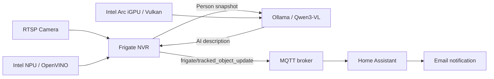

# Zettlab D6 Ultra: Frigate + Intel NPU + Intel Arc iGPU + Ollama

**Local AI security camera alerts on an Intel Core Ultra NAS, with no cloud AI API required.**

This project demonstrates an **Intel Core Ultra 5 125H / 32 GB RAM Zettlab D6 Ultra** setup using:

- **Frigate 0.18.2** + **OpenVINO on the Intel NPU** for `person`, `car`, etc. detection
- **Ollama on the Intel Arc iGPU (Vulkan)** with **Qwen3-VL** for natural-language descriptions
- **MQTT + optional Home Assistant** to email descriptions and event timestamps
- An **RTSP camera** (Reolink in the original setup; other RTSP cameras can work)

> **Status and provenance:** This is a **sanitized starter configuration based on a working personal deployment**, not a byte-for-byte export of the live NAS. The NPU detector and Intel GPU Ollama inference were verified in that setup. Object-description email alerts were working; full-video Review AI summaries were **not** consistently working due to large image prompts and 120-second timeouts. This repository enables **single-snapshot person object descriptions** by default and leaves Review GenAI disabled. Adjustments may be needed for your Zettlab firmware, host Intel drivers, camera, and model.

## How it works



The NPU **detects the object**; the iGPU **runs the image-understanding model**. Neither guarantees a description for every event. The Ollama request must finish successfully first.

## Repository files

| File | Purpose |
|---|---|
| `docker-compose.yml` | Frigate and Ollama containers + Intel hardware access |
| `.env.example` | Public placeholder values for private MQTT/RTSP settings |
| `frigate/config.example.yml` | Sample Frigate NPU detector, Ollama GenAI, person alerts, recordings |
| `home-assistant/person-ai-email.example.yaml` | Optional MQTT-to-email HA automation |
| `.gitignore` | Prevents committing private `.env`, runtime config and camera media |
| `SECURITY.md` | Privacy and publication checklist |

## Prerequisites

1. An x86-64 Zettlab NAS (or Linux host) with **Intel Core Ultra NPU** and **Intel Arc iGPU**, with devices exposed by the host kernel. Other Zettlab models may not have an Intel NPU.
2. Docker Engine + Docker Compose.
3. A working RTSP camera and an accessible MQTT broker (e.g. Mosquitto in Home Assistant).
4. A host kernel/Intel NPU firmware combination compatible with Frigate's bundled OpenVINO/Intel NPU runtime. Do **not** mount host NPU libraries into the container.
5. Host `/dev/accel/accel0` and `/dev/dri/renderD128` (render node number can vary).

Check the hardware **on the NAS host**, not inside the Windows command prompt:

```sh
ls -la /dev/accel /dev/dri
```

## Quick start

### 1. Download/clone, then create the private files

```sh
cp .env.example .env
mkdir -p frigate/config frigate/media ollama/data
cp frigate/config.example.yml frigate/config/config.yml
```

Edit **`.env`** with your actual broker IP/user/password and full camera RTSP URL. Keep it private. If your camera password contains reserved URL characters, percent-encode them within the RTSP URL.

Edit **`frigate/config/config.yml`** as needed:

- `cameras.reolink.detect.width/height` must match your camera's **detect stream** (the example's 1920x720 is specific to one camera setup).
- Update `ui.timezone` and retention periods.
- Reolink RTSP paths differ among camera models. Test the stream before debugging object detection.
- The built-in `/openvino-model/ssdlite_mobilenet_v2.xml` and matching label map are from Frigate's OpenVINO getting-started example.

**Do not paste passwords directly into the public sample YAML.** Frigate substitutes the `FRIGATE_...` variables set in Docker Compose.

### 2. Start containers

```sh
docker compose config --quiet
docker compose up -d
```

Open `https://YOUR-NAS-LAN-IP:8971` and finish Frigate's initial authentication setup. The HTTPS certificate may be self-signed.

### 3. Download the vision model

The uploaded Frigate example now uses **Qwen3-VL 8B Instruct**, matching the provided Zettlab configuration. Download that model before enabling GenAI:

```sh
docker compose exec ollama ollama pull qwen3-vl:8b-instruct
```

For lower latency and memory usage, **4B** is an optional alternative:

```sh
docker compose exec ollama ollama pull qwen3-vl:4b-instruct
```

If switching to 4B, also change `genai.local_ollama.model` in the private `frigate/config/config.yml`, then restart Frigate. The model tag in Frigate must match the tag pulled in Ollama.

### 4. Verify GPU/NPU and AI messages

```sh
# Check Ollama's loaded-model processor (after at least one AI request):
docker compose exec ollama ollama ps

# Inspect recent Ollama and Frigate logs:
docker compose logs --tail=100 ollama
docker compose logs --tail=100 frigate
```

When a Qwen3-VL model is loaded and executing on the iGPU, `ollama ps` should show a GPU processor percentage. If it says CPU, check `/dev/dri`, Vulkan, drivers and Ollama logs; `OLLAMA_IGPU_ENABLE=1` was helpful on the original Intel Arc iGPU setup.

In Frigate **System Metrics**, check that the `intel_npu` detector is active and inference timings are available. The original setup observed approximately **6 ms** NPU inference, but speed varies.

For descriptions, use an MQTT client or **Home Assistant → Settings → Devices & services → MQTT → Configure → Listen to a topic**:

```text
frigate/tracked_object_update
```

A successful AI object description uses an event resembling:

```json
{
  "type": "description",
  "id": "EXAMPLE-EVENT-ID",
  "description": "A person wearing a dark jacket is walking past the entrance."
}
```

This example is illustrative, not an actual recording.

### 5. Optional Home Assistant email alerts

Import/adapt `home-assistant/person-ai-email.example.yaml` into Home Assistant's automation editor. Replace `notify.YOUR_SMTP_ENTITY` with your actual working notification entity. Test SMTP separately first.

**Note:** The object-description MQTT message has an event ID and description but not a ready-to-send image or clip attachment. The example includes **links** to Frigate media, not attached files. They generally require a valid Frigate login and can return HTTP **401 Unauthorized** when opened outside an authenticated session. The recording must exist for a clip to play.

## Known limitations / troubleshooting

| Symptom | Things to check |
|---|---|
| `NPU` not found | Host `/dev/accel`, firmware compatibility, Docker device mapping |
| Ollama model running on CPU | `/dev/dri`, Intel Vulkan drivers, Ollama logs, `OLLAMA_IGPU_ENABLE` |
| No description MQTT events | Enable `objects.genai`, track `person`, wait until an object exits, inspect Frigate/Ollama logs |
| `request (25909 tokens) exceeds ... 16384` | Review-video requests sent too many frames/tokens. Snapshot-only object descriptions are the default here |
| `POST /api/generate` fails after ~120s | Model timed out. Try 4B, avoid parallel requests and disable heavy Review GenAI |
| Frigate media link returns 401 | Authenticated port 8971 requires a login; don't expose port 5000 to bypass authentication |
| Missing photo/video in email | MQTT description messages contain only text and an event ID; file attachments need a separate HA media download/email step |

## Enabling optional full-video Review AI

The sample sets `review.genai.enabled: false` because long multi-frame reviews overwhelmed the original 8B/16K-context setup. After snapshot descriptions work reliably, you can experiment with `review.genai.enabled: true`; keep `image_source: preview` first. Watch Frigate's `review_descriptions` logs and Ollama's context/timeout errors. Review summaries and object descriptions are **different** pipelines and MQTT message types.

## Publish to GitHub

1. Create a **public** repository at [github.com/new](https://github.com/new) named `zettlab-frigate-intel-npu-igpu` (leave auto-generated README unchecked because this project already contains one).
2. From the directory containing these files, run the following commands after reviewing their contents:

   ```sh
   git init
   git branch -M main
   git add .
   git status --short
   git diff --cached --name-only
   git commit -m "Share Frigate Intel NPU and Ollama iGPU example"
   git remote add origin https://github.com/YOUR_GITHUB_USERNAME/zettlab-frigate-intel-npu-igpu.git
   git push -u origin main
   ```

3. Replace `YOUR_GITHUB_USERNAME` before pushing. **Stop if `git status` lists `.env`, `frigate/config/config.yml`, camera media, or Ollama model files.** They must not be published.
4. Optionally add an MIT license using GitHub's license chooser if you want others to reuse and redistribute the example under those terms.
5. Share the final repository URL in the Zettlab Facebook group with your hardware and software versions. Do not post logs containing credentials or actual camera screenshots without checking privacy.

If you prefer GitHub's web interface, you can instead use **Add file → Upload files** and upload only the seven sample files from this project. Remember to preserve the `frigate/` and `home-assistant/` folder structure.

## Security notes

Review [`SECURITY.md`](SECURITY.md) before making the repository public. This Compose file intentionally does **not** publish Ollama's port 11434 or Frigate's unauthenticated port 5000. It is still your responsibility to restrict host access to the LAN/VPN and set secure credentials.

## References

- [Frigate installation and Docker Compose](https://docs.frigate.video/frigate/installation/)
- [Frigate OpenVINO detector and Intel NPU](https://docs.frigate.video/configuration/object_detectors/)
- [Frigate OpenVINO sample model](https://docs.frigate.video/guides/getting_started/)
- [Frigate object AI descriptions](https://docs.frigate.video/configuration/genai/genai_objects/)
- [Frigate Ollama GenAI configuration](https://docs.frigate.video/configuration/genai/genai_config/)
- [Frigate MQTT tracked object updates](https://docs.frigate.video/integrations/mqtt/)
- [Ollama Docker GPU/Vulkan documentation](https://github.com/ollama/ollama/blob/main/docs/docker.mdx)

**Not officially affiliated with Zettlab, Frigate, Intel, Ollama, or Reolink.**